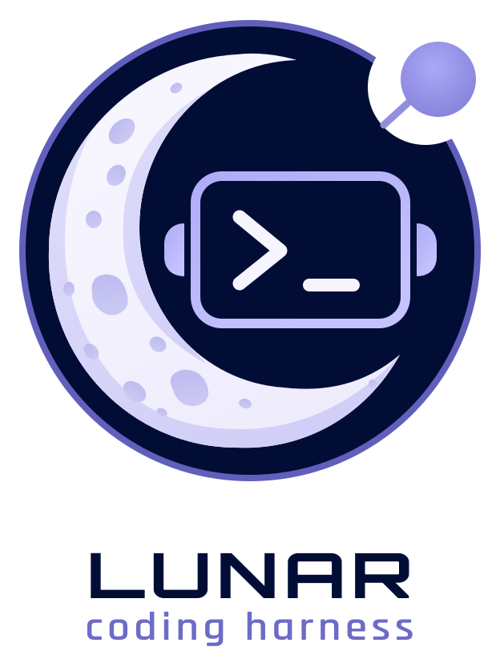

<p align="center">
  <picture>
    <source media="(prefers-color-scheme: dark)" srcset="docs/logos/dark/lunar-dark-theme-with-wordmark-transparent.svg">
    <source media="(prefers-color-scheme: light)" srcset="docs/logos/light/lunar-logo-with-wordmark-transparent.svg">
    
  </picture>
</p>

<p align="center">
  <a href="https://github.com/gszr/lunar/actions/workflows/ci.yml"></a>
  <a href="https://github.com/gszr/lunar/releases"></a>
  <a href="LICENSE"></a>
</p>

<p align="center">Your harness. Your choice</p>

<p align="center">Inspired by <a href="https://github.com/earendil-works/pi">Pi &lt;3</a>. Configured with Lua. Built for transparency and customizability</p>

<p align="center"></p>

## Lunar Coding Harness

Lunar is deliberately small: a Rust host owns the terminal, model transport, and 
four tools, while a Lua guest supplies model and provider configuration. It does 
not impose plan modes, sub-agents, approval prompts, or another workflow between you 
and the model.

## Features

- Want to use your xAI, OpenAI, or Anthropic[^anthropic-policy] subscriptions? No problem, Lunar
  [can help](docs/models.md#subscription-sign-in).
- Want to bring your own provider and API key? Okay, you are [one config away](docs/configuration.md).
- Want to easily switch between models, providers, and formats mid session with
  no restarts? No problem, [`/model`](docs/models.md#selecting-models) (or cmd+shift+m!) is there for you.
- Want to get a sample curl request of what the next request will be?
  [`/request slim` or `/request full`](docs/request-export.md) to the rescue.
- Want to see where your tokens are going? Use [`/context` or
  `/context raw`](docs/context.md#inspecting-context), or keep an eye on the [status bar](docs/diagnostics.md#token-usage).
- Want to change the config and reapply without a restart? [`/config`](docs/configuration.md).
- Want to inspect the provider response headers? Toggle [`/debug` mode](docs/diagnostics.md#response-diagnostics).
- Want to see provider responses in plain text instead of rendered markdown? 
  [`/markdown`](docs/terminal.md#replies)
- Working across repositories? Use [stacks](docs/stacks.md) and the LLM will know where to check!
- Want a global default provider/model and per repo overrides? [`.lunar/init.lua`](docs/configuration.md#overrides-and-modules)
  is there for the ride.

## Install

```bash
brew install --HEAD gszr/taps/lunar
```

Or with Cargo:

```bash
cargo install --git https://github.com/gszr/lunar
```

## Run

Run `lunar`, type a prompt, and press Enter. Use `/login` and `/model` for a
subscription, or `/config` to configure a provider. `/help` lists commands;
`lunar --help` lists launch options. Ctrl+D quits.

## Documentation

See [feature documentation](docs/README.md) for configuration, examples, and usage.

## Status

Lunar is early software for macOS and Linux.

## License

[MIT](LICENSE)

[^anthropic-policy]: Using Anthropic subscription tokens with any non-Claude harness is against Anthropic's policy and may result in an account ban. Use at your own risk.
